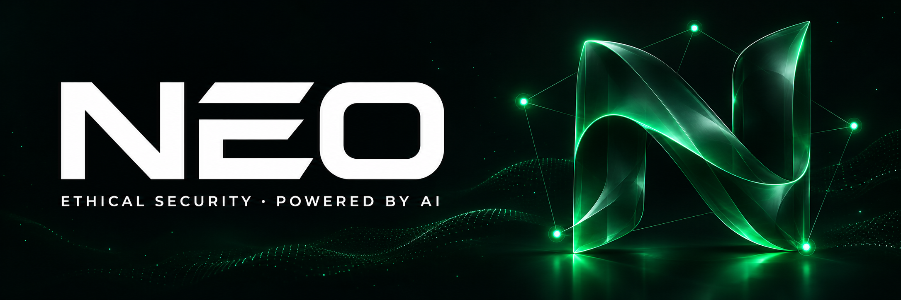
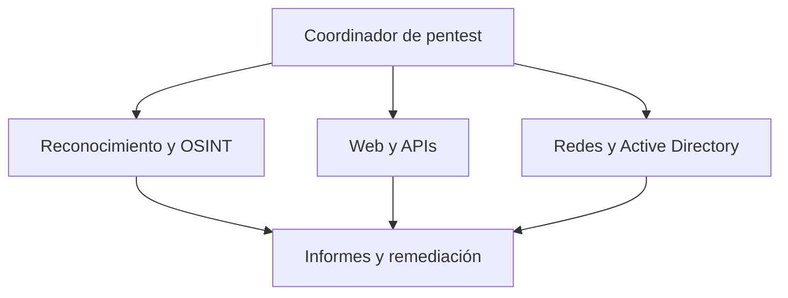

<p align="center">
  
</p>

<h1 align="center">Ciberseguridad con agentes de IA</h1>

<p align="center">
  Del reconocimiento al informe, en un mismo entorno.<br>
  Pentesting ético, OSINT y análisis de seguridad para Claude Code.
</p>

<p align="center">
  
  
  
</p>

<p align="center">
  <a href="#capacidades">Capacidades</a> ·
  <a href="#inicio-rápido">Inicio rápido</a> ·
  <a href="#ejemplos-de-uso">Ejemplos</a> ·
  <a href="execution/SETUP.md">Configuración</a>
</p>

---

**Neo conecta metodología, conocimiento y ejecución.** Un coordinador organiza la auditoría y trabaja con cuatro especialistas en reconocimiento, aplicaciones web, redes e informes. Una base de conocimiento local respalda el análisis; los backends MCP permiten ejecutar herramientas cuando están instalados y disponibles.

> [!IMPORTANT]
> Exclusivamente para sistemas propios, pruebas con permiso explícito, formación y CTF. Antes de cualquier acción activa, define el objetivo, la autorización y el nivel de intrusividad. Consulta [AUTHORIZATION.md](AUTHORIZATION.md).

## Capacidades

| Área | Qué puedes hacer | Herramientas y referencias |
| :--- | :--- | :--- |
| **Reconocimiento y OSINT** | Investigar la exposición pública de dominios y empresas, enumerar activos y organizar hallazgos. | Shodan, DNS, crt.sh, Wayback, nmap, amass, subfinder, theHarvester. |
| **Web y APIs** | Revisar superficies de ataque y validar vulnerabilidades dentro del alcance acordado. | OWASP WSTG, nuclei, sqlmap, ffuf, nikto, WPScan. |
| **Redes y Active Directory** | Enumerar servicios, evaluar configuraciones y analizar rutas de ataque en entornos autorizados. | SMB, LDAP, Kerberos, Impacket, enum4linux, CrackMapExec. |
| **Cloud, contenedores y código** | Revisar configuraciones, dependencias y código propio o autorizado. | HexStrike: Prowler, Trivy, Checkov; raptor: Semgrep, SCA y SBOM. |
| **Informes y evidencias** | Documentar hallazgos, severidad, CVSS, impacto y remediación. | Reporting; VulnForce para gestión y exportación PDF, HTML y Markdown. |

La disponibilidad depende del backend y de las herramientas instaladas. Neo también incluye [image-recon](tools/image-recon/README.md): metadatos, hashes perceptuales y búsqueda de similitud en un corpus de imágenes propio o autorizado.

## Cinco agentes, un flujo de trabajo



| Agente | Responsabilidad |
| :--- | :--- |
| [`pentest-orchestrator`](.claude/agents/pentest-orchestrator.md) | Define las fases, coordina especialistas y consolida el trabajo. |
| [`recon-osint`](.claude/agents/recon-osint.md) | Reconocimiento pasivo y activo, superficie expuesta e investigación pública. |
| [`web-exploit`](.claude/agents/web-exploit.md) | Seguridad de aplicaciones web y APIs con metodología OWASP WSTG. |
| [`network-ad`](.claude/agents/network-ad.md) | Servicios de red, Active Directory y movimiento lateral en laboratorios o auditorías autorizadas. |
| [`reporting`](.claude/agents/reporting.md) | Evidencia reproducible, valoración del riesgo e informes con remediación. |

### Conocimiento disponible sin conexión

Neo incluye una copia local de las **767 páginas** de la [Ethical Hacking Cheatsheet de afsh4ck](https://afsh4ck.gitbook.io/ethical-hacking-cheatsheet).

| Referencia | Contenido |
| :--- | :--- |
| [`knowledge/00-index.md`](knowledge/00-index.md) | Índice para localizar cada tema. |
| [`knowledge/cheatsheet-full.md`](knowledge/cheatsheet-full.md) | Referencia consolidada. |
| [`knowledge/pages/`](knowledge/pages/) | Páginas individuales con la jerarquía original. |
| [`knowledge/osint/shodan-queries.md`](knowledge/osint/shodan-queries.md) | Consultas de Shodan para investigación autorizada. |

La referencia se consulta localmente; Claude Code necesita su propia instalación y acceso al modelo.

## Inicio rápido

### 1. Clona el repositorio

```bash
git clone -c core.longpaths=true https://github.com/excelenciaempire/neo.git
cd neo
```

### 2. Abre Neo en Claude Code

Abre Claude Code desde la raíz de `neo/`. Allí están los cinco agentes, las instrucciones del proyecto y la base de conocimiento. **Docker no es necesario para planificar, consultar la referencia o redactar informes.**

El OSINT en vivo requiere un navegador disponible y configurado; los agentes utilizan `browser-harness`.

### 3. Añade ejecución de herramientas

Para ejecutar herramientas reales, instala Docker Desktop y, en Windows, WSL2. Clona las dependencias desde PowerShell:

```powershell
pwsh resources/setup.ps1
```

Después, desde Git Bash y con Docker en ejecución:

```bash
bash resources/kali-mcp/init.sh
bash execution/setup-hexstrike.sh
```

Reinicia Claude Code para cargar las conexiones de [`.mcp.json`](.mcp.json). La [guía de ejecución](execution/SETUP.md) detalla los requisitos, la verificación y la instalación adicional de VulnForce y raptor.

### Elige qué necesitas activar

| Componente | Para qué sirve | Requisito |
| :--- | :--- | :--- |
| **Agentes + conocimiento** | Planificación, metodología, consulta e informes. | Claude Code. |
| **OSINT en vivo** | Consultar fuentes públicas desde el navegador. | `browser-harness` configurado. |
| **kali-mcp** | Ejecutar herramientas de seguridad en Kali. | Docker; endpoint local `:666/mcp`. |
| **HexStrike AI** | Ampliar las herramientas de ejecución. | Contenedor `kali-mcp` y script de instalación; servidor interno `:8888`. |
| **VulnForce** | Gestionar proyectos, hallazgos y exportaciones. | Servicio adicional; MCP local `:47474/api/mcp`. |

## Ejemplos de uso

Indica el entorno y el alcance en tu petición.

**Planificar una auditoría**

```text
Usa pentest-orchestrator para planificar una auditoría de mi laboratorio
10.10.10.5. Empieza con reconocimiento y confirma el alcance antes de ejecutar.
```

**Investigar la exposición pública**

```text
recon-osint: investiga la exposición pública de mi empresa en example.com.
Limita esta fase a OSINT pasivo y documenta las fuentes.
```

**Revisar una aplicación propia**

```text
web-exploit: prepara una revisión OWASP WSTG de mi aplicación de staging.
Primero define conmigo la URL, las credenciales de prueba y las acciones permitidas.
```

**Convertir evidencias en un informe**

```text
reporting: consolida las evidencias de esta auditoría en un informe
con resumen ejecutivo, severidad, impacto y remediación por hallazgo.
```

## Estructura del proyecto

```text
neo/
├── .claude/agents/      # Coordinador y cuatro especialistas
├── .mcp.json            # Conexiones con los backends
├── assets/              # Banner e identidad del repositorio
├── execution/           # Instalación y configuración de ejecución
├── knowledge/           # Índice, referencia completa y páginas individuales
├── resources/           # Setup de herramientas externas; clones no versionados
├── tools/image-recon/   # Utilidad propia de OSINT por imagen
├── AUTHORIZATION.md     # Alcance y reglas de uso
└── CLAUDE.md            # Instrucciones para los agentes
```

## Uso responsable

Trabaja con permiso escrito, sistemas propios o laboratorios y CTF. Las herramientas intrusivas requieren confirmación explícita antes de ejecutarse. No se permiten ataques destructivos, DoS, targeting indiscriminado ni exfiltración masiva; conserva únicamente la evidencia necesaria.

El OSINT de personas se limita a datos públicos con un fin autorizado, sin acoso ni desanonimización. Las credenciales, los datos de clientes y los informes sensibles **no se suben al repositorio**. Las exclusiones de herramientas y sus motivos están en [`resources/README.md`](resources/README.md).

Consulta la política completa en [AUTHORIZATION.md](AUTHORIZATION.md).

## Créditos y licencias de terceros

Neo reúne trabajo propio y proyectos de la comunidad. Cada recurso conserva su autoría y licencia; consulta el repositorio original antes de reutilizarlo o redistribuirlo.

| Proyecto | Autoría | Aporte |
| :--- | :--- | :--- |
| [Ethical Hacking Cheatsheet](https://afsh4ck.gitbook.io/ethical-hacking-cheatsheet) | afsh4ck | Base de conocimiento. |
| [WSTG-Scan](https://github.com/afsh4ck/WSTG-Scan) / [VulnForce](https://github.com/afsh4ck/VulnForce) | afsh4ck | Auditoría web y gestión de informes. |
| [awesome-shodan-queries](https://github.com/jakejarvis/awesome-shodan-queries) | jakejarvis | Consultas para OSINT. |
| [kali-mcp](https://github.com/pabpereza/kali-mcp) / [HexStrike AI](https://github.com/0x4m4/hexstrike-ai) | pabpereza / 0x4m4 | Backends de ejecución. |
| [raptor](https://github.com/gadievron/raptor) | gadievron | Análisis estático y de dependencias. |

El inventario y las condiciones de las integraciones están en [`resources/README.md`](resources/README.md).
